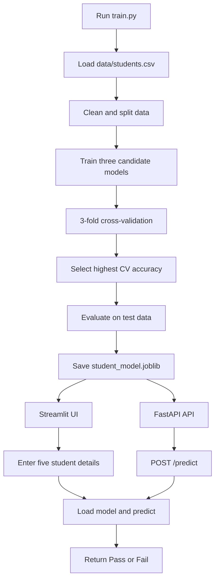

# Student Pass Predictor

A small machine-learning application that predicts whether a student is likely to pass from five inputs:

- `study_hours`: study hours per day, from 0 to 24
- `previous_marks`: previous exam marks, from 0 to 100
- `attendance`: attendance percentage, from 0 to 100
- `assignments_completed`: completed assignment percentage, from 0 to 100
- `sleep_hours`: average sleep per night, from 0 to 12

The project includes a training script, a Streamlit web interface, a FastAPI REST API, and a Docker image.

## Project Flow



  ## Dataset

  The training data is stored in [data/students.csv](data/students.csv). It contains 25 sample student records. Each row represents one student and includes five input features plus the known outcome used for supervised learning.

  | Column | Meaning | Range or values |
  | --- | --- | --- |
  | `student_id` | Unique sample identifier | `S001` to `S025` |
  | `study_hours` | Study hours per day | 0 to 24 |
  | `previous_marks` | Previous exam marks | 0 to 100 |
  | `attendance` | Attendance percentage | 0 to 100 |
  | `assignments_completed` | Percentage of assignments completed | 0 to 100 |
  | `sleep_hours` | Average sleep per night | 0 to 12 |
  | `passed` | Target label | `1` = Pass, `0` = Fail |

  The dataset is intentionally small and educational. It is included in the repository so training is repeatable, but it is not a real institutional dataset and should not be used to make academic decisions.

### End-to-end explanation

1. `data/students.csv` contains 25 sample students with study hours, previous marks, attendance, assignment completion, sleep hours, and the known pass/fail label.
2. `train.py` loads the CSV and validates the labeled rows before training.
3. The data is cleaned by removing duplicates and rows without a target value.
4. The features are split into training and test sets. Stratification keeps the pass/fail proportions similar in both sets.
5. Three pipelines are compared: Logistic Regression with median imputation and scaling, a Decision Tree with maximum depth 3, and a Random Forest with 100 trees and maximum depth 3.
6. Three-fold cross-validation is performed on the training data.
7. The model with the best average cross-validation accuracy is selected and fitted on the full training set.
8. The selected model is evaluated against the test set and saved as `student_model.joblib`.
9. The Streamlit app or FastAPI app loads that saved pipeline. Both send the same five feature names to the model and convert the prediction into `Pass` or `Fail`.

## Model Training and Results

### Features and target

The model uses these five input features:

```text
study_hours
previous_marks
attendance
assignments_completed
sleep_hours
```

The target is `passed`:

- `1` means the student passed.
- `0` means the student failed.

The `student_id` column is not used as a feature because it identifies a row but has no predictive meaning.

### Data preparation

`train.py` performs the following preparation steps:

1. Loads the CSV with pandas.
2. Removes duplicate rows.
3. Removes rows where `passed` is missing.
4. Separates the five features (`X`) from the target (`y`).
5. Splits the data into 75% training data and 25% test data using `random_state=42`.
6. Uses stratification so the pass/fail ratio is preserved in both splits.

Each candidate model is placed in a scikit-learn pipeline. Missing numeric feature values are replaced with the median using `SimpleImputer`. Logistic Regression also standardizes the inputs with `StandardScaler`.

### Candidate models

The training script compares three classification algorithms:

| Model | Configuration | Purpose |
| --- | --- | --- |
| Logistic Regression | Median imputation, standard scaling, `max_iter=1000` | A simple, interpretable linear baseline for pass/fail classification |
| Decision Tree | Median imputation, `max_depth=3`, `random_state=42` | Learns readable rule-like splits while limiting overfitting |
| Random Forest | Median imputation, 100 trees, `max_depth=3`, `random_state=42` | Combines multiple shallow trees for a more flexible classifier |

### How the model is selected

The script evaluates every candidate on the training portion with 3-fold cross-validation. In each fold, the model trains on two parts and validates on the remaining part. The three validation accuracies are averaged into one cross-validation score.

The model with the highest mean cross-validation accuracy is selected. This is preferable to choosing a model from the test set because the test set is kept separate for the final, one-time evaluation.

### Latest measured results

These results were produced by running `python train.py` on the included 25-row CSV:

| Candidate model | Mean 3-fold CV accuracy |
| --- | ---: |
| Logistic Regression | **0.889** (88.9%) |
| Random Forest | 0.833 (83.3%) |
| Decision Tree | 0.778 (77.8%) |

**Selected model: Logistic Regression.** It was selected because its mean cross-validation accuracy, 88.9%, was higher than the Random Forest score of 83.3% and the Decision Tree score of 77.8%.

After selection, Logistic Regression was fitted again using all available training rows. On the untouched 25% test split, it achieved:

| Metric | Result |
| --- | ---: |
| Test accuracy | **1.000 (100%)** |
| Fail precision | 1.000 |
| Fail recall | 1.000 |
| Fail F1-score | 1.000 |
| Pass precision | 1.000 |
| Pass recall | 1.000 |
| Pass F1-score | 1.000 |

The test split contained 7 students: 3 failures and 4 passes. A 100% result on such a small test split does not mean the model is perfect in real-world use. The cross-validation score is a more useful estimate here, and the dataset should be expanded with representative, independently collected data before drawing strong conclusions.

### Saved model

The selected, fitted pipeline is serialized to `student_model.joblib`. It contains the preprocessing steps and classifier together, so the Streamlit app and FastAPI service apply the same feature handling at prediction time. This generated model file is excluded from Git; each user creates it locally by running the training script.

To reproduce the results:

```powershell
python train.py
```

The command prints each cross-validation score, the selected model, test accuracy, a classification report, and saves a new `student_model.joblib` file.

## Project Files

| File | Purpose |
| --- | --- |
| `train.py` | Loads the dataset, trains candidate models, evaluates them, and saves the best pipeline. |
| `data/students.csv` | Included labeled dataset used by `train.py`, containing 25 sample students. |
| `student_model.joblib` | Generated serialized model pipeline used at prediction time; excluded from Git and recreated by `train.py`. |
| `streamlit_app.py` | Browser-based user interface. |
| `app.py` | FastAPI REST API with `/` and `/predict` endpoints. |
| `requirements.txt` | Pinned Python dependencies. |
| `Dockerfile` | Instructions for building the Streamlit container image. |

## Run Locally

### Prerequisites

Install Python 3.12 or later. Clone or download the repository, then open a terminal in the project folder.

### 1. Create and activate a virtual environment

**Windows PowerShell**

```powershell
py -3.12 -m venv .venv
.\.venv\Scripts\Activate.ps1
```

If PowerShell blocks activation, run this once in an appropriate PowerShell session:

```powershell
Set-ExecutionPolicy -Scope CurrentUser RemoteSigned
```

**macOS / Linux**

```bash
python3.12 -m venv .venv
source .venv/bin/activate
```

### 2. Install dependencies

Run these commands after activating the environment:

```bash
python -m pip install --upgrade pip
python -m pip install -r requirements.txt
```

`joblib` is still a required Python dependency: the training script uses it to save the model, and both apps use it to load the model. The generated `student_model.joblib` file is ignored by Git, so each user needs to create it once.

### 3. Train the model

```bash
python train.py
```

This reads `data/students.csv`, prints cross-validation scores and evaluation results, and creates `student_model.joblib` in the project folder. Run this before launching Streamlit or FastAPI, and rerun it after changing the dataset or training code.

### 4. Start the Streamlit interface

```bash
python -m streamlit run streamlit_app.py
```

Open http://localhost:8501 in a browser. Enter the five student details, then select **Predict result**.

### 5. Start the FastAPI service instead

In another terminal, activate the virtual environment and run:

```bash
python -m uvicorn app:app --reload --host 127.0.0.1 --port 8000
```

Open http://localhost:8000/docs for the interactive Swagger API documentation.

Test the API from Windows PowerShell:

```powershell
Invoke-RestMethod -Method Post `
  -Uri http://localhost:8000/predict `
  -ContentType "application/json" `
  -Body '{"study_hours": 6, "previous_marks": 76, "attendance": 91, "assignments_completed": 90, "sleep_hours": 8}'
```

Example response:

```json
{
  "prediction": 1,
  "result": "Pass"
}
```

The API validates every numeric feature against its documented range.

## Docker

### How the image is built

The `Dockerfile`:

1. Starts from the lightweight `python:3.12-slim` image.
2. Creates `/app` as the container working directory.
3. Copies `requirements.txt` first so dependency installation can be cached.
4. Installs the pinned dependencies.
5. Copies the application source and training CSV into `/app`.
6. Runs `train.py` during the image build to create the model inside the image. The local `.joblib` file is excluded from the Docker build context.
7. Configures Streamlit to listen on `0.0.0.0:8501`, which makes it reachable outside the container.
8. Starts `streamlit_app.py` when the container launches.

The model is generated and packaged inside the image. Rebuild the image after changing the training data or model code.

### Build the image

Run this from the folder containing the `Dockerfile`:

```powershell
docker build -t student-pass-predictor .
```

### Run the Streamlit application

For the standard port:

```powershell
docker run --rm -p 8501:8501 student-pass-predictor
```

Open http://localhost:8501.

To run it in the background with a name:

```powershell
docker run -d --name student-pass-predictor -p 8501:8501 student-pass-predictor
```

View logs:

```powershell
docker logs -f student-pass-predictor
```

Stop and remove the background container:

```powershell
docker stop student-pass-predictor
docker rm student-pass-predictor
```

### Run when port 8501 is already occupied

The first number is the Windows host port. The second number is the container port and remains `8501`:

```powershell
docker run -d --name student-pass-predictor -p 8502:8501 student-pass-predictor
```

Open http://localhost:8502 and check the container health endpoint:

```powershell
curl.exe http://localhost:8502/_stcore/health
```

Expected response:

```text
ok
```

Find which container is using a port:

```powershell
docker ps
```

### Run the FastAPI service in Docker

The default Docker command starts Streamlit. To use the same image as an API container, override the command and publish port 8000:

```powershell
docker run --rm -p 8000:8000 student-pass-predictor `
  uvicorn app:app --host 0.0.0.0 --port 8000
```

Open http://localhost:8000/docs, or test it with:

```powershell
Invoke-RestMethod -Method Post `
  -Uri http://localhost:8000/predict `
  -ContentType "application/json" `
  -Body '{"study_hours": 6, "previous_marks": 76, "attendance": 91, "assignments_completed": 90, "sleep_hours": 8}'
```

## Important Docker Commands

```powershell
# List running containers
docker ps

# List all containers
docker ps -a

# List local images
docker images

# Rebuild after changing source code or the model
docker build --no-cache -t student-pass-predictor .

# Remove the image when it is no longer needed
docker rmi student-pass-predictor
```

## Troubleshooting

### Port is already allocated

Another process or container is already using the host port. Use another host port, for example:

```powershell
docker run --rm -p 8502:8501 student-pass-predictor
```

### Model file not found

For a local run, generate the ignored model file before starting either app:

```powershell
python train.py
```

Docker builds generate the model from `data/students.csv` automatically. If a Docker build fails while training, confirm the CSV is present and rebuild the image.

### Check container logs

```powershell
docker logs student-pass-predictor
```

### Confirm the image starts

```powershell
docker run --rm -p 8501:8501 student-pass-predictor
```

The log should contain a message that the Streamlit app is available at port 8501.

## Seminar Summary

This project demonstrates the complete machine-learning lifecycle:

1. Prepare a labeled dataset.
2. Clean and split the data.
3. Compare multiple classification algorithms.
4. Select a model using cross-validation.
5. Evaluate the selected model.
6. Serialize the trained pipeline with Joblib.
7. Serve predictions through a Streamlit interface or FastAPI endpoint.
8. Package the application and its generated model together in Docker for repeatable execution.

The main benefit of Docker is consistency: the Python version, dependencies, application code, and trained model are packaged together, so the application can run the same way on another machine with Docker installed.